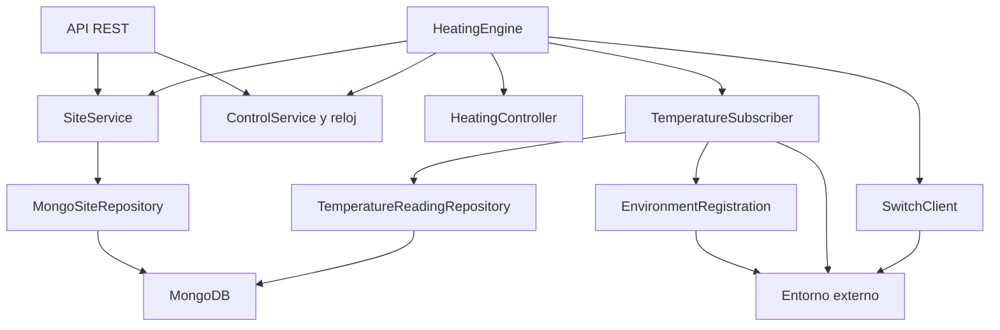
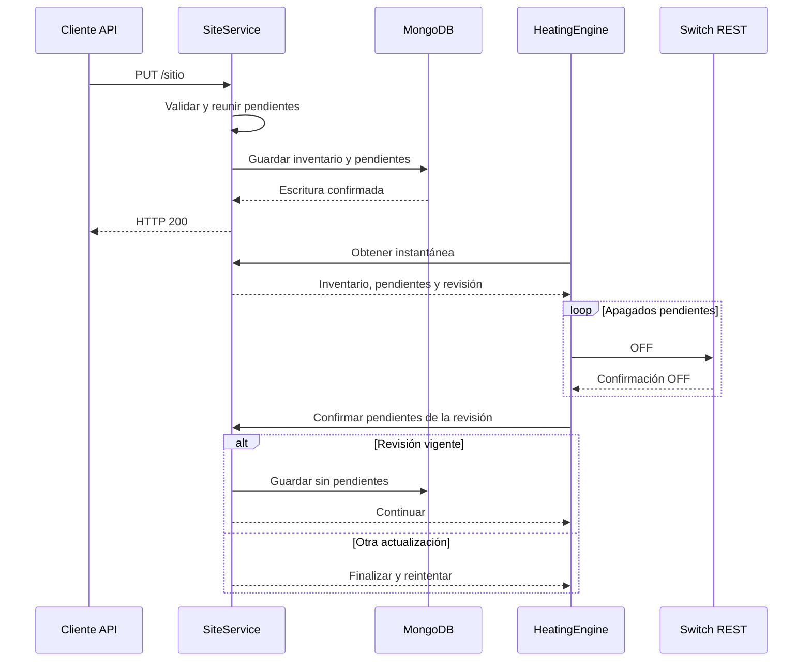
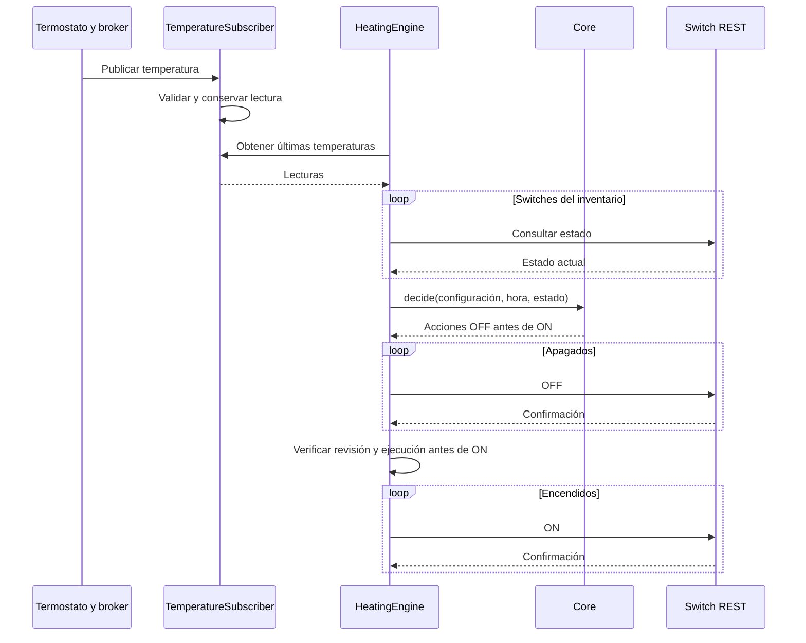

# Arquitectura 4+1 - Iteración 4

## Alcance y vista lógica

Esta iteración comienza con vista lógica y secuencias de eventos.

Las restantes vistas se completarán en las iteraciones 5 y 6.

- core: modelo y decisión, sin comunicaciones externas.
- engine: API, suscriptor MQTT, reloj, MongoDB y switches REST.

Engine depende de core.

API y suscriptor se ejecutan en el mismo proceso y contenedor control.

## Modelo y responsabilidades

| Componente | Responsabilidad |
|---|---|
| HeatingController | Decidir acciones ON/OFF |
| PeakSchedule | Evaluar horario punta |
| RoomState | Datos para selección por temperatura y potencia |
| RoomConfig / SiteConfig | Configuración del core |
| RoomObservation / ControlState | Estado observado y ejecución |
| SwitchAction / Decision | Lista ordenada de acciones |
| HeatingEngine | Reunir datos y ejecutar decisiones |
| SiteController / SiteService | API y gestión del inventario |
| SiteValidator | Validar configuración |
| SiteRepository / MongoSiteRepository | Persistir configuración y pendientes |
| ControlController / ControlService | Estado, comandos y reloj |
| VirtualClock | Avance del tiempo virtual |
| EnvironmentRegistration | Registro y broker |
| TemperatureSubscriber | Recepción MQTT y última lectura |
| TemperatureReadingRepository | Guardar histórico |
| SwitchClient | Consultar y comandar switches REST |
| SecurityConfig | Protección X-API-Key |
| ApiExceptionHandler | Errores REST gestionados |

Los records del modelo completo están dentro de HeatingController.

decide(configuración, hora, estado) devuelve Decision sin realizar IO.

## Decisiones de diseño

La selección prioriza:

temperatura objetivo - temperatura actual

Se ordena de mayor a menor déficit y se desempata por ID.

Se selecciona una habitación si cabe su potencia en la disponible.
Si una no cabe, se continúa con las siguientes.

Durante punta o sin lectura disponible no se selecciona la habitación.

La decisión compara selección y estado de switches.

Evita comandos innecesarios y ordena todos los OFF antes de los ON.

Un estado desconocido requiere OFF antes de cualquier eventual ON.

Engine confirma los comandos y detiene el ciclo si uno falla.

## Tiempo e inventario

El reloj conserva su factor numérico y calcula tiempo virtual desde
el instante inicial y el tiempo real transcurrido.

INICIAR resincroniza y conserva el desplazamiento para evaluar
la hora local.

La franja es [desde, hasta).
HABILES representa lunes a viernes.

El factor del controlador no acelera la simulación térmica del checker.

SiteService guarda inventory y pendingShutdowns en site_config,
documento con _id active, antes de modificar la memoria.

Mantiene las direcciones de los switches anteriores.

PUT /sitio no llama a switches.
Un inventario idéntico no agrega pendientes.

HeatingEngine procesa pendientes incluso detenido.

Los conserva si falla un apagado.
Solo retira pendientes cuando su revisión sigue vigente.

Inventario y pendientes se recuperan después de un reinicio.

## Temperaturas y timestamp

TemperatureSubscriber conserva la última lectura por topic en memoria
y solicita guardarla en temperature_readings.

Un método privado de TemperatureSubscriber convierte ts del protocolo
a long en milisegundos, leyendo el decimal exactamente sin paso por double.

sourceTs y payload.ts se guardan como BSON Int64.
sourceTsUnit indica epoch_milliseconds.

receivedAt es la fecha real de recepción.

Si falla la escritura, la lectura permanece en memoria.
No hay reintentos históricos automáticos.

Tras reiniciar se espera una nueva lectura MQTT.

## Concurrencia e integración

SiteService y ControlService sincronizan sus operaciones.

HeatingEngine evita ciclos propios simultáneos.

Las llamadas REST a switches no mantienen bloqueados
los servicios de sitio y control.

Antes de cada ON se comprueba revisión, ejecución y resincronización.

No es una transacción distribuida:
los ciclos posteriores reconcilian los cambios.

El registro POST /controladores obtiene el broker.

Las suscripciones se adaptan al inventario.

Recibir temperatura no comanda directamente el switch.

El simulador docente reemplaza generator y stub para la integración.

## Secuencia de actualización del inventario

## Secuencia de temperatura y decisión

Precondiciones:

- Inventario cargado.
- Control en ejecución.
- MQTT conectado.
- Apagados pendientes procesados.

El guardado del histórico se realiza desde el suscriptor como operación
adicional a la actualización de la última temperatura en memoria.

## Validación

Pruebas ejecutadas:

- Core: 23 pruebas.
- Engine: 43 pruebas.
- Total: 66 pruebas.

Resultado comprobado con Java 25: BUILD SUCCESS,
sin fallos ni errores.

El 11 de octubre de 2026, hora de Uruguay, el checker obtuvo 8/8,
con 18 comandos y 204 consultas de estado.

Esta validación confirma la comunicación REST y MQTT de la versión probada.
No reemplaza los tests del core.

Las dos lecturas más recientes inspeccionadas en MongoDB tenían
sourceTs y payload.ts de tipo long y unidad epoch_milliseconds.

La recuperación de pendientes se prueba con colaboradores simulados.

Queda ampliar las pruebas con infraestructura real en la iteración 5,
completar las restantes vistas y comprobar el histórico antiguo en MongoDB.