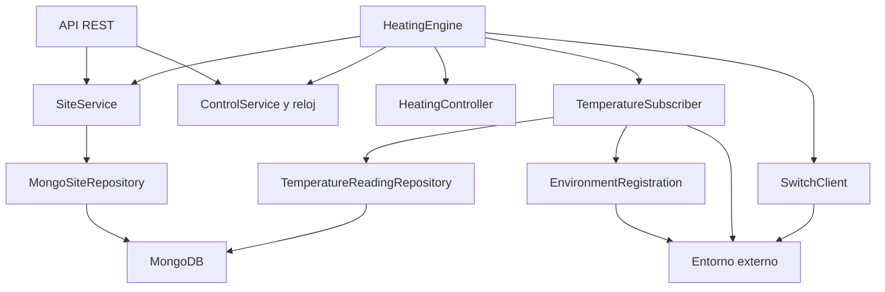
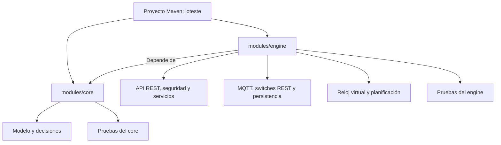
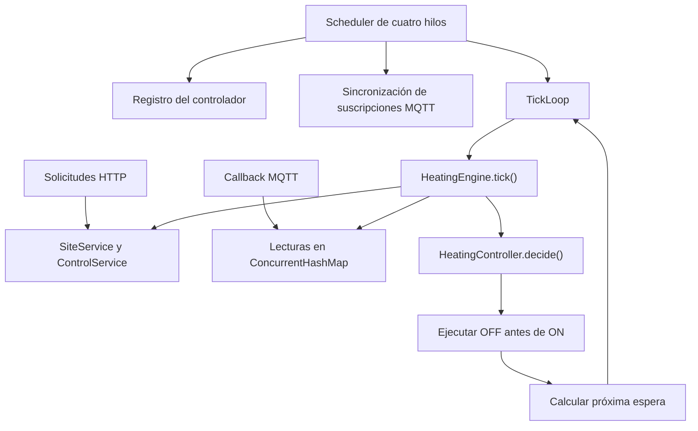
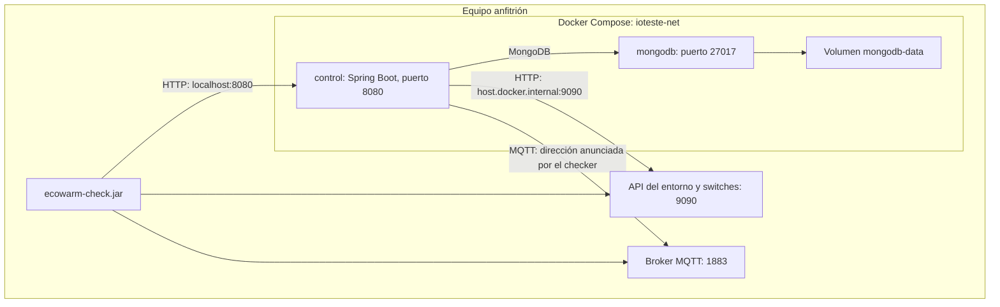
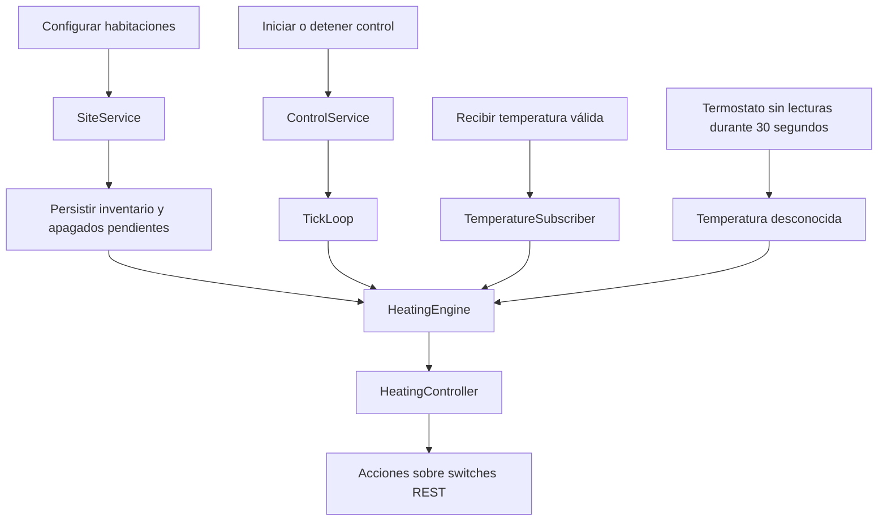
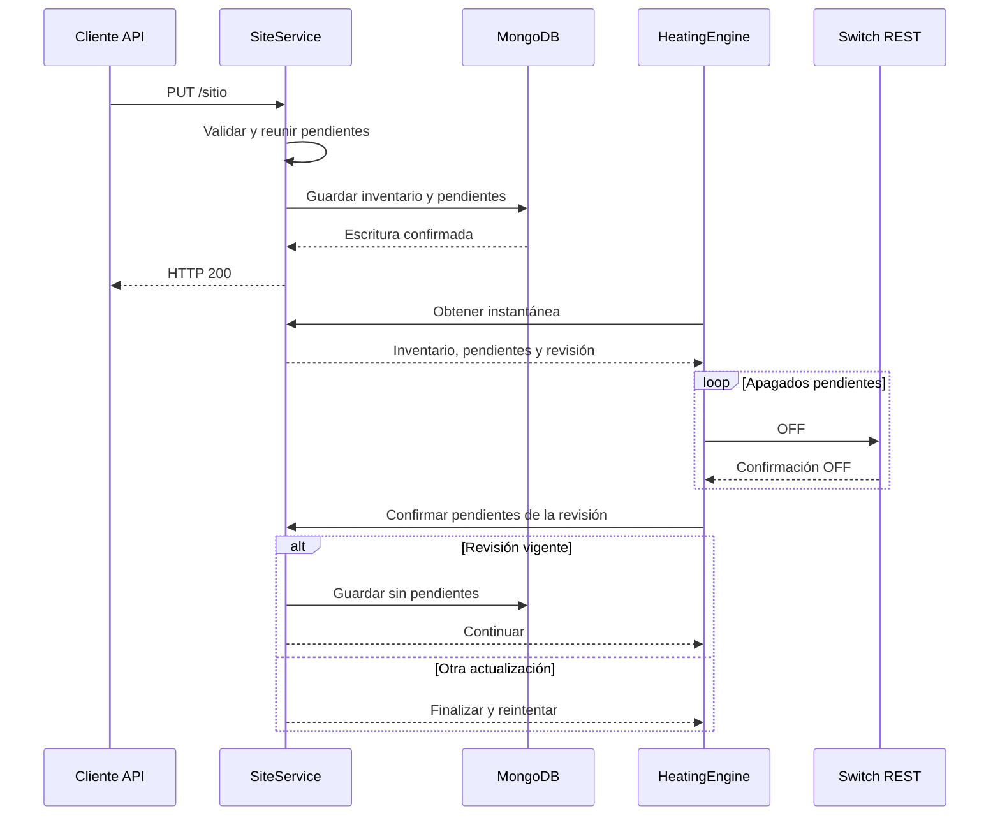
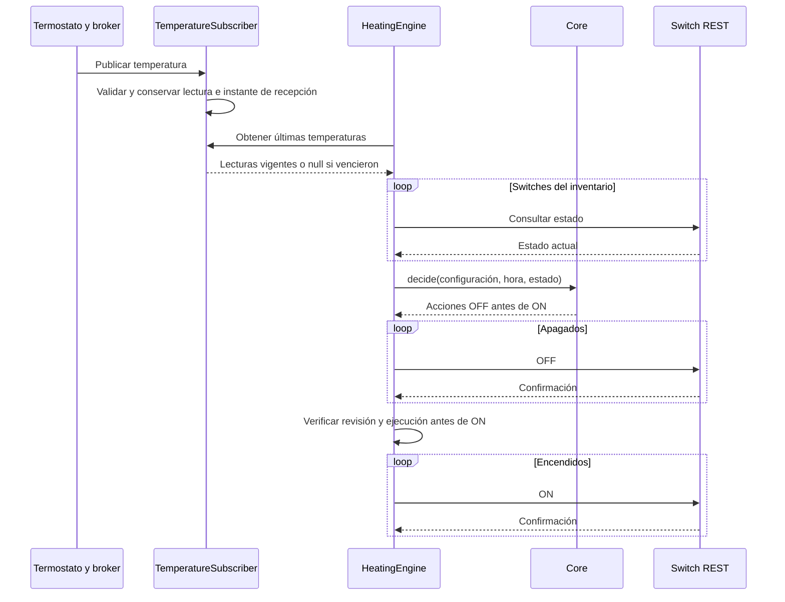

# Arquitectura 4+1 - Iteración 5

## Alcance y vista lógica

Se incluyen las vistas lógica, de desarrollo, de procesos, física
y de escenarios (+1).

- core: modelo y decisión, sin comunicaciones externas.
- engine: API, suscriptor MQTT, reloj, MongoDB y switches REST.

Engine depende de core.

API y suscriptor se ejecutan en el mismo proceso y contenedor control.



## Modelo y responsabilidades

| Componente | Responsabilidad |
|---|---|
| HeatingController | Decidir acciones ON/OFF |
| PeakSchedule | Evaluar horario punta |
| RoomState | Datos para selección por temperatura y potencia |
| RoomConfig / SiteConfig | Configuración del core |
| RoomObservation / ControlState | Estado observado y ejecución |
| SwitchAction / Decision | Lista ordenada de acciones |
| HeatingEngine | Reunir datos y ejecutar decisiones |
| SiteController / SiteService | API y gestión del inventario |
| SiteValidator | Validar configuración |
| SiteRepository / MongoSiteRepository | Persistir configuración y pendientes |
| ControlController / ControlService | Estado, comandos y reloj |
| VirtualClock | Avance del tiempo virtual |
| EnvironmentRegistration | Registro y broker |
| TemperatureSubscriber | Recepción MQTT, última lectura y control de vigencia |
| TemperatureReadingRepository | Guardar histórico |
| SwitchClient | Consultar y comandar switches REST |
| SecurityConfig | Protección X-API-Key |
| ApiExceptionHandler | Errores REST gestionados |

Los records del modelo del core están dentro de HeatingController,
salvo los tipos definidos en archivos propios.

decide(configuración, hora, estado) devuelve Decision sin realizar IO.

## Decisiones de diseño

La selección prioriza:

temperatura objetivo - temperatura actual

Se ordena de mayor a menor déficit y se desempata por ID.

Se selecciona una habitación si cabe su potencia en la disponible.
Si una no cabe, se continúa con las siguientes.

Durante punta o sin lectura disponible no se selecciona la habitación.

La decisión compara selección y estado de switches.

Evita comandos innecesarios y ordena todos los OFF antes de los ON.

Un estado desconocido requiere OFF antes de cualquier eventual ON.

Engine confirma los comandos y trata los fallos por habitación.
Un apagado fallido no impide intentar los demás apagados. Los encendidos
solo se permiten si, considerando las habitaciones que no se pudieron
apagar como posibles consumidoras, no se supera la potencia máxima.
Los ciclos posteriores vuelven a consultar el estado y reintentan las
acciones que sigan siendo necesarias.

## Tiempo e inventario

El reloj conserva su factor numérico y calcula tiempo virtual desde
el instante inicial y el tiempo real transcurrido.

INICIAR resincroniza el reloj. La hora local se calcula siempre con la
zona única del sitio (America/Montevideo, configurable con ECOWARM_ZONE),
sin depender del offset de la fecha recibida.

La franja es [desde, hasta).
HABILES representa lunes a viernes.

El factor del controlador no acelera la simulación térmica del checker.

SiteService guarda inventory y pendingShutdowns en site_config,
documento con _id active, antes de modificar la memoria.

Mantiene las direcciones de los switches anteriores.

PUT /sitio no llama a switches.
Un inventario idéntico no agrega pendientes.

HeatingEngine procesa pendientes incluso detenido.

Los conserva si falla un apagado.
Solo retira pendientes cuando su revisión sigue vigente.

Inventario y pendientes se recuperan después de un reinicio.

## Temperaturas y timestamp

TemperatureSubscriber conserva la última lectura por topic en memoria
y solicita guardarla en temperature_readings.

Un método privado de TemperatureSubscriber convierte ts del protocolo
a long en milisegundos, leyendo el decimal exactamente sin paso por double.

sourceTs y payload.ts se guardan como BSON Int64.
sourceTsUnit indica epoch_milliseconds.

receivedAt es la fecha real de recepción.

Si falla la escritura, la lectura permanece en memoria.
No hay reintentos históricos automáticos.

Tras reiniciar se espera una nueva lectura MQTT.

Cada lectura válida se almacena junto con el instante de recepción en
milisegundos. Su vigencia se define mediante TEMPERATURE_TIMEOUT_MS,
con un valor fijo de 30.000 milisegundos reales, independiente del
factor de aceleración del controlador.

TemperatureSubscriber utiliza un Clock: en producción obtiene la hora
actual mediante Clock.systemUTC() y en las pruebas permite simular
el paso del tiempo en milisegundos.

Al cumplirse 30 segundos sin una nueva lectura válida, temperature()
devuelve null. El core interpreta la temperatura como desconocida y
ordena apagar esa habitación si su estado lo requiere en el próximo
ciclo de control.

Una nueva lectura válida restablece la temperatura disponible. Los
mensajes inválidos no renuevan el plazo de vigencia.

## Concurrencia e integración

SiteService y ControlService sincronizan sus operaciones.

HeatingEngine evita ciclos propios simultáneos.

El ciclo de control no usa una espera fija. TickLoop ejecuta tick() y
vuelve a programarlo con la espera que calcula HeatingEngine.nextDelay():
normalmente 1 s reales, pero menos si el reloj virtual llega antes al
próximo cambio de franja (TickPlanner, con PeakSchedule.nextChange).
Con tiempo acelerado, una espera fija de 1 s equivaldría a factor × 1 s
virtuales y el corte de la franja punta llegaría tarde.

El ciclo arranca cuando la aplicación está lista, sin espera inicial, y se
despierta de inmediato cuando el control se inicia, resincroniza o detiene.
Si durante un ciclo el reloj cruza un límite de franja, se repite enseguida.

Las tareas programadas usan un scheduler de 4 hilos (SchedulingConfig).
Con el valor por defecto de Spring, de 1 hilo, el registro, las
suscripciones MQTT y el ciclo de control se bloqueaban entre sí.

En cada ciclo la hora virtual se lee después de consultar los switches,
que es la parte lenta, para decidir con la hora más reciente.

Cada habitación se consulta y se comanda por separado: un switch sin
respuesta se trata como estado desconocido y no impide apagar los
demás. Si un apagado falla, los encendidos solo se hacen si, contando esa
habitación como encendida, no se supera la potencia máxima del sitio.

Las llamadas REST a switches no mantienen bloqueados
los servicios de sitio y control.

Antes de cada ON se comprueba revisión, ejecución y resincronización.

No es una transacción distribuida:
los ciclos posteriores reconcilian los cambios.

El registro POST /controladores obtiene el broker.

Las suscripciones se adaptan al inventario.

El cliente MQTT tiene habilitada la reconexión automática. Al conectarse
o perder la conexión, se limpia el registro local de suscripciones.
La tarea de sincronización vuelve a suscribir los topics del inventario
cuando la conexión está disponible.

Recibir temperatura no comanda directamente el switch.

El simulador docente reemplaza generator y stub para la integración.

## Vista de desarrollo

El proyecto se organiza en dos módulos Maven:

- core contiene el modelo y la lógica de decisión, sin dependencias de
  Spring, MQTT, REST ni MongoDB.
- engine contiene los adaptadores y la coordinación del controlador.
  Depende de core.

Las pruebas se ubican en src/test/java dentro de cada módulo.



La separación permite probar las decisiones del core sin infraestructura
externa. Engine transforma la configuración y las observaciones en
entradas del core y ejecuta las acciones devueltas.

Las pruebas MQTT de engine incorporan Testcontainers como dependencia
de alcance test. Utilizan brokers Mosquitto temporales y no agregan
dependencias de producción ni servicios al docker-compose de la aplicación.

## Vista de procesos

El controlador se ejecuta en una JVM. Las solicitudes HTTP, las tareas
programadas y los callbacks MQTT pueden ejecutarse concurrentemente.

SchedulingConfig configura un scheduler con cuatro hilos para las tareas
de registro, sincronización de suscripciones y control.

TickLoop programa el siguiente ciclo después de ejecutar el actual.
HeatingEngine sincroniza tick() para evitar evaluaciones simultáneas.



SiteService y ControlService sincronizan el acceso a sus estados.
HeatingEngine utiliza una instantánea del inventario y comprueba su
revisión antes de encender.

Las lecturas MQTT se conservan en un ConcurrentHashMap. Cada entrada
contiene la temperatura y su instante de recepción.

Las comunicaciones REST no mantienen bloqueados los servicios de sitio
y control. Los cambios concurrentes se reconcilian en los ciclos
posteriores; no existe una transacción distribuida.

## Vista física o de despliegue

Docker Compose despliega dos servicios:

- control: aplicación Spring Boot con engine y core, expuesta en el
  puerto 8080.
- mongodb: persistencia de configuración, apagados pendientes e histórico
  de temperaturas, con volumen mongodb-data.

El checker se ejecuta como un proceso Java en el host. Proporciona la
API del entorno y los switches REST en el puerto 9090, además del broker
MQTT en el puerto 1883.



El checker se inicia con:

```powershell
java -jar ".\ecowarm-check.jar" --anunciar host.docker.internal
```

El controlador se registra mediante POST /controladores y obtiene la
dirección del broker MQTT.

El contenedor control accede al entorno del host mediante
host.docker.internal. La configuración del volumen permite conservar
los datos de MongoDB al recrear los contenedores.

Los brokers creados por Testcontainers pertenecen únicamente al entorno
de pruebas. Utilizan puertos publicados dinámicamente y no reemplazan
al broker del checker en el despliegue de la aplicación.

## Vista de escenarios (+1)

Los escenarios relacionan las operaciones externas con los componentes
que colaboran para resolverlas.



### Control sin limitación efectiva de potencia

Con el control iniciado, fuera de horario punta y con lecturas vigentes,
el core selecciona las habitaciones que requieren calefacción y cuya
potencia conjunta cabe en la potencia contratada.

Engine ejecuta los comandos necesarios y evita repetirlos cuando los
switches ya tienen el estado correcto.

### Control con limitación efectiva de potencia

Cuando no pueden calentarse todas las habitaciones simultáneamente,
el core prioriza el mayor déficit de temperatura y desempata por ID.

Engine ejecuta los apagados antes de los encendidos. Si un apagado falla,
considera que esa habitación puede seguir consumiendo y evita los
encendidos que superarían la potencia máxima.

### Vencimiento y recuperación de un termostato

Una lectura válida permite evaluar la necesidad de calefacción.
Al cumplirse 30 segundos reales sin otra lectura válida,
TemperatureSubscriber devuelve null.

El core excluye la habitación de la selección y ordena apagar si su
estado lo requiere. Una nueva lectura válida permite reanudar el control.

Los mensajes inválidos no renuevan el plazo de vigencia.

Una interrupción de recepción menor al plazo mantiene disponible la última
lectura. Si llega una nueva lectura válida, el plazo se cuenta desde
esa nueva recepción.

### Caída y recuperación de comunicaciones

Ante una caída de MQTT, el controlador continúa ejecutando sus ciclos.
Las temperaturas anteriores vencen según su plazo de vigencia.

El cliente intenta recuperar la conexión y la tarea de sincronización
restablece las suscripciones. Las nuevas lecturas permiten reanudar
el control normal.

Ante una falla REST, Engine trata el estado del switch como desconocido
si no puede consultarlo. Los fallos de comandos se registran y los ciclos
posteriores vuelven a intentar las acciones necesarias.

La recuperación del entorno completo se verificó manualmente reiniciando
el checker, sin reiniciar el controlador.

También se verificó una interrupción aislada de la comunicación MQTT
bloqueando el puerto 1883 desde la red del contenedor del controlador,
con REST disponible. Al retirar el bloqueo se recuperaron la conexión,
las suscripciones, las lecturas y el control, sin reiniciar los procesos.

La detención real del servidor MQTT se verifica adicionalmente mediante
una prueba automatizada que detiene y arranca el proceso Mosquitto.
El contenedor conserva su dirección y el suscriptor utiliza el mismo
cliente MQTT durante la recuperación.

Otra prueba publica mensajes no retenidos durante la ausencia temporal
de suscripción. Esas publicaciones no renuevan la lectura; después de
restablecer la suscripción, una publicación nueva recupera la temperatura.

### Cambio de configuración durante la ejecución

SiteService valida y persiste el nuevo inventario junto con los apagados
pendientes de dispositivos anteriores.

Engine procesa esos pendientes antes de tomar nuevas decisiones.
Antes de ejecutar un encendido comprueba que la revisión de la
configuración siga vigente.

Una prueba con SiteService y ControlService reales verifica que reducir
la temperatura esperada durante la ejecución provoca el apagado,
resuelve los pendientes y conserva el control en marcha.

### Arranque y parada del controlador

Al quedar lista la aplicación, TickLoop comienza a ejecutar ciclos.

INICIAR establece o resincroniza el reloj virtual y despierta el ciclo.
DETENER cambia el estado del control y también despierta el ciclo para
reconciliar el estado de los switches.

Con el control detenido, el core no selecciona habitaciones para calentar.
Los apagados pendientes del inventario se procesan incluso en ese estado.

Una prueba con servicios reales y comunicaciones simuladas verifica
el recorrido INICIAR, encender, DETENER y apagar.

## Secuencia de actualización del inventario



## Secuencia de temperatura y decisión

Precondiciones del escenario:

- Inventario cargado.
- Control en ejecución.
- MQTT conectado.
- Apagados pendientes procesados.



El guardado del histórico se realiza desde el suscriptor como operación
adicional a la actualización de la última temperatura en memoria.

El ciclo de control continúa aunque MQTT esté desconectado. Las lecturas
anteriores dejan de estar disponibles al vencer su plazo de vigencia.

## Validación

Pruebas ejecutadas:

- Core: 34 pruebas.
- Engine: 86 pruebas.
- Total: 120 pruebas.

Las pruebas incorporadas verifican el vencimiento de las lecturas a los
30 segundos reales, la recuperación con una lectura válida y que los
mensajes inválidos no renuevan la vigencia. También comprueban que
HeatingEngine ordena apagar por vencimiento y permite volver a encender
al recibir una nueva lectura válida.

Se verifica además una ausencia de mensajes de 20 segundos, durante
la cual la lectura sigue vigente, y su renovación con una lectura nueva.

Las pruebas de vigencia utilizan un reloj simulado, sin esperar
30 segundos reales.

Las pruebas de integración comprueban el recorrido INICIAR, encender,
DETENER y apagar, y la reducción de la temperatura esperada durante
la ejecución utilizando SiteService y ControlService reales.

Resultado comprobado con Java 25: BUILD SUCCESS,
sin fallos, errores ni pruebas omitidas.

La suite completa se verificó mediante clean verify y scripts/test.sh.
Requiere un motor Docker accesible para las pruebas con Testcontainers.

El archivo modules/engine/src/test/resources/docker-java.properties
configura api.version=1.44 para el cliente Docker de las pruebas,
compatible con el Docker Engine 29 del entorno probado.

Cobertura del core medida con JaCoCo:

- Instrucciones: 98 %.
- Ramas: 93 %.

El reporte se conserva en docs/calidad/cobertura/core/.

### Recuperación del entorno completo

Se realizó una prueba manual deteniendo y reiniciando el checker mientras
el controlador permanecía en ejecución. Los logs mostraron la reconexión
MQTT, la renovación de ambas suscripciones, la recepción de temperaturas
y la reanudación de los comandos de calefacción.

El checker reúne MQTT, termostatos y switches REST. Por lo tanto, esta
prueba verifica la recuperación del entorno completo.

### Interrupción aislada de la comunicación MQTT

Se bloqueó el tráfico TCP saliente hacia el puerto 1883 desde la red
del contenedor ioteste-control, manteniendo REST disponible en 9090.

La interrupción se mantuvo durante más de 30 segundos y luego se retiró
el bloqueo. No se reiniciaron el controlador ni el checker.

Los logs del 28 de octubre de 2026 mostraron los siguientes eventos,
con horarios en UTC:

| Evento | Hora UTC |
|---|---|
| Última lectura de room1 y pérdida de conexión MQTT | 03:12:57.895 |
| Confirmación OFF de sw-room1 | 03:13:28.540 |
| Reconexión MQTT | 03:15:49.353 |
| Renovación de ambas suscripciones | 03:15:49.355 y 03:15:49.356 |
| Nuevas temperaturas de ambas habitaciones | 03:15:52 |
| Confirmaciones ON de ambos switches | 03:15:53 |

El apagado de room1 se confirmó aproximadamente 30,6 segundos después
de su última lectura. Room2 ya estaba apagada antes del corte.

Los comandos confirmados muestran que REST permaneció disponible.
La recuperación de MQTT permitió reanudar el control con lecturas nuevas.

El procedimiento reproducible de bloqueo y restauración se documenta
en README.md.

Esta prueba manual simula una interrupción de red hacia MQTT.
La detención real del proceso del broker se verifica por separado
en la prueba automatizada con Mosquitto.

### Detención y recuperación de un broker real

La prueba realBrokerRestartAllowsSubscriptionAndReadingRecovery,
ubicada en TemperatureSubscriberTest, utiliza Testcontainers y
eclipse-mosquitto:2.0.22.

El procedimiento verifica:

1. Conexión y suscripción a un broker real.
2. Recepción de una temperatura inicial.
3. Detención del proceso Mosquitto y detección de la desconexión.
4. Vencimiento de la lectura mediante el reloj simulado.
5. Arranque de Mosquitto dentro del mismo contenedor.
6. Recuperación de conexión y suscripción con el mismo cliente MQTT.
7. Recepción de una temperatura nueva.

El contenedor permanece activo durante la detención de Mosquitto.
Se conserva el puerto publicado y no se reinicia el suscriptor.

La prueba pasó junto con las otras ocho pruebas de
TemperatureSubscriberTest y posteriormente en la suite completa.

### Publicaciones no entregadas

La prueba publicationsMissedWithoutSubscriptionDoNotRenewTheReading
utiliza un broker real y retira temporalmente la suscripción del cliente.

Durante ese intervalo se publican dos mensajes no retenidos.
Se comprueba que la última temperatura disponible no cambió y que
vence al cumplirse su plazo original.

Después se restablece la suscripción y se publica una lectura nueva.
La temperatura vuelve a estar disponible y se comprueba que el
repositorio recibió únicamente la lectura inicial y la nueva.

Esta prueba verifica pérdida de entrega de publicaciones por ausencia
de suscripción. No inyecta pérdidas individuales de paquetes TCP.

### Checker e inspección de persistencia

El 28 de octubre de 2026, hora de Uruguay, el checker obtuvo 8/8,
con 18 comandos y 156 consultas de estado.

Este resultado confirma la interoperabilidad REST y MQTT evaluada por
el checker. No reemplaza los tests del core ni las pruebas específicas
de fallas de comunicación.

En una inspección anterior, las dos lecturas más recientes de MongoDB
tenían sourceTs y payload.ts de tipo long y unidad epoch_milliseconds.

La recuperación de pendientes se prueba con colaboradores simulados.

La inyección de pérdidas individuales de paquetes TCP y la comprobación
del histórico antiguo de MongoDB no se realizaron en estas pruebas.

Las temperaturas, potencias y el factor de aceleración se representan
internamente con `long` escalado a milésimas. Los adaptadores JSON/MQTT
convierten los números decimales en la frontera de entrada y salida.