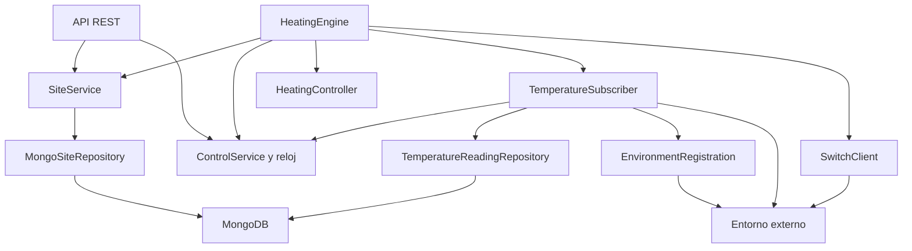
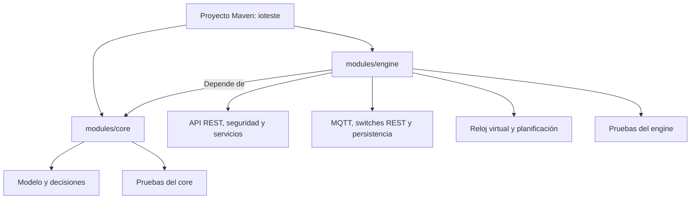
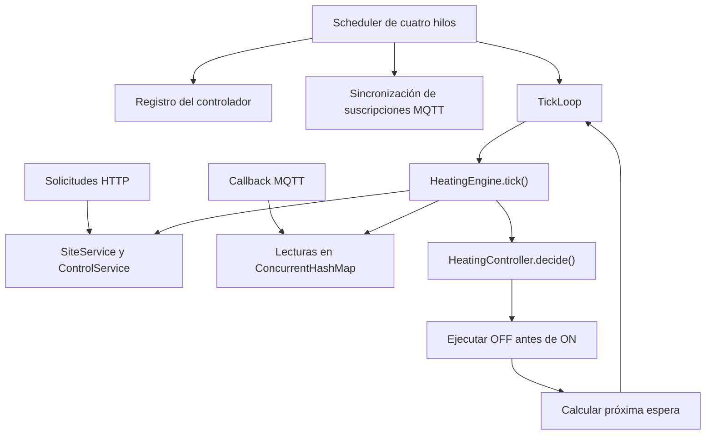
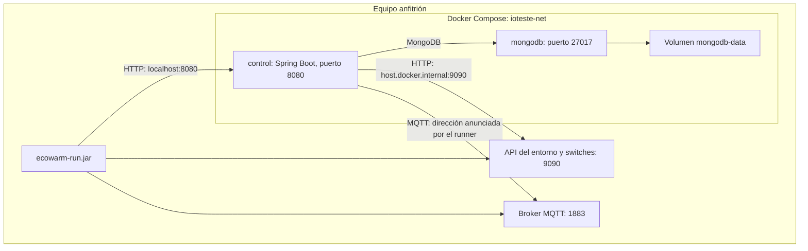
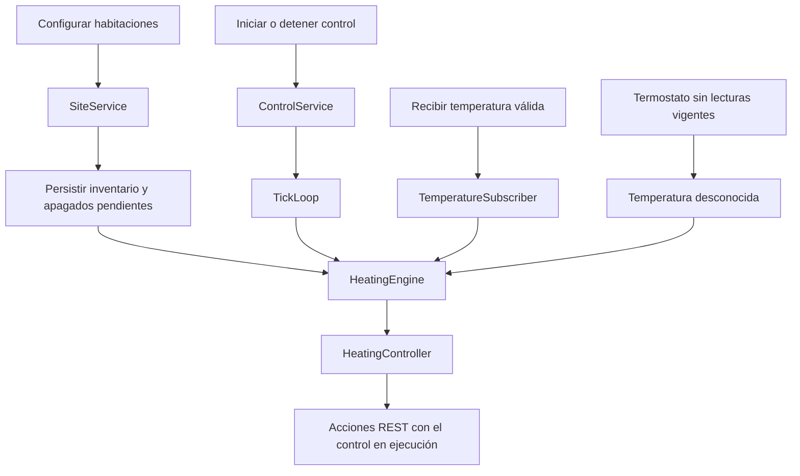
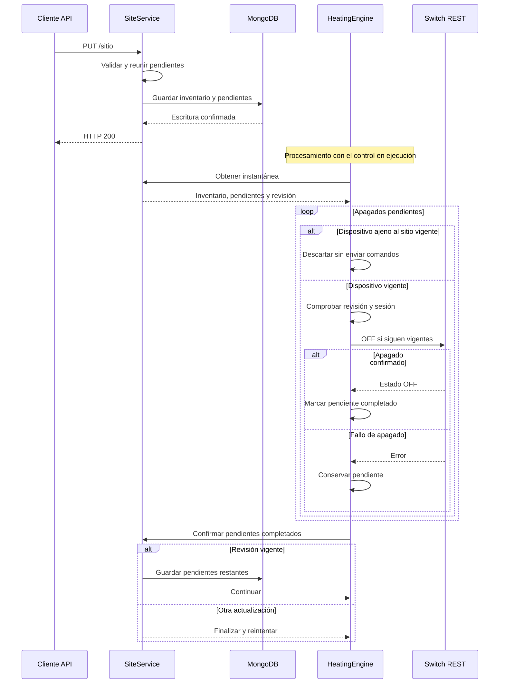
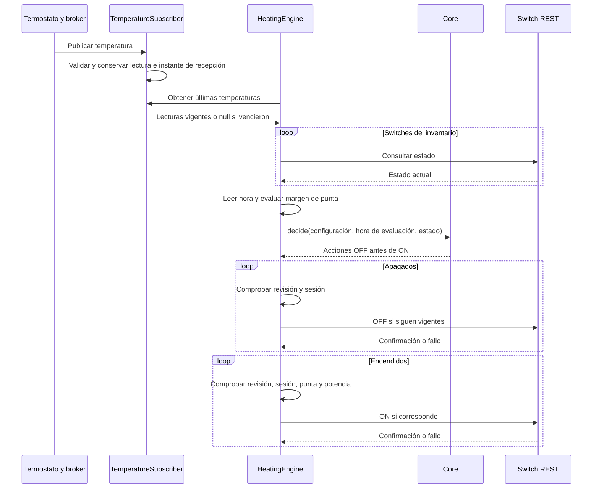

# Arquitectura 4+1 - Iteración 6

## Alcance y vista lógica

Se incluyen las vistas lógica, de desarrollo, de procesos, física
y de escenarios (+1).

- core: modelo y decisión, sin comunicaciones externas.
- engine: API, suscriptor MQTT, reloj, MongoDB y switches REST.

Engine depende de core.

API y suscriptor se ejecutan en el mismo proceso y contenedor control.



## Modelo y responsabilidades

| Componente | Responsabilidad |
|---|---|
| HeatingController | Decidir acciones ON/OFF |
| PeakSchedule | Evaluar horario punta |
| RoomState | Datos para selección por temperatura y potencia |
| RoomConfig / SiteConfig | Configuración del core |
| RoomObservation / ControlState | Estado observado y ejecución |
| SwitchAction / Decision | Lista ordenada de acciones |
| HeatingEngine | Reunir datos y ejecutar decisiones |
| SiteController / SiteService | API y gestión del inventario |
| SiteValidator | Validar configuración |
| SiteRepository / MongoSiteRepository | Persistir configuración y pendientes |
| ControlController / ControlService | Estado, comandos y reloj |
| VirtualClock | Avance del tiempo virtual |
| EnvironmentRegistration | Registro y broker |
| TemperatureSubscriber | Recepción MQTT, última lectura y control de vigencia |
| TemperatureReadingRepository | Guardar histórico |
| SwitchClient | Consultar y comandar switches REST |
| SecurityConfig | Protección X-API-Key |
| ApiExceptionHandler | Errores REST gestionados |

Los records del modelo del core están dentro de HeatingController,
salvo los tipos definidos en archivos propios.

decide(configuración, hora, estado) devuelve Decision sin realizar IO.

## Decisiones de diseño

### Separación entre decisión e integración

El core recibe valores y devuelve acciones sin acceder a la red,
al reloj del sistema ni a la base de datos.

Engine reúne las observaciones, obtiene la hora virtual y ejecuta
las acciones. Esto permite probar las reglas sin infraestructura externa
y verificar por separado las comunicaciones.

### Selección de habitaciones

La selección prioriza:

temperatura objetivo - temperatura actual

Se ordena de mayor a menor déficit y se desempata por ID.

Se selecciona una habitación si cabe su potencia en la disponible.
Si una no cabe, se continúa con las siguientes.

Durante punta o sin lectura disponible no se selecciona la habitación.

La decisión compara selección y estado de switches.

Evita comandos innecesarios y ordena todos los OFF antes de los ON.

Un estado desconocido requiere OFF antes de cualquier eventual ON.

Engine confirma los comandos y trata los fallos por habitación.
Un apagado fallido no impide intentar los demás apagados. Los encendidos
solo se permiten si, considerando las habitaciones que no se pudieron
apagar como posibles consumidoras, no se supera la potencia máxima.

Los ciclos posteriores vuelven a consultar el estado y reintentan las
acciones que sigan siendo necesarias.

### Detención del control

DETENER interrumpe el envío de comandos a switches.
No representa una orden de apagado general.

HeatingEngine finaliza el ciclo si el control está detenido y no procesa
apagados pendientes en ese estado.

Aunque el core puede producir acciones OFF al recibir un estado detenido,
el motor no las ejecuta.

### Vigencia de las observaciones

La última temperatura se conserva en memoria con su instante de recepción.
El vencimiento impide continuar calentando indefinidamente con una
observación antigua.

Se considera el factor de tiempo vigente y se mantiene un límite máximo
de 30 segundos reales. Las lecturas inválidas no renuevan la vigencia.

### Cambios concurrentes

Cada evaluación utiliza una instantánea del inventario y una sesión
de ejecución.

Antes de cada comando se comprueba que ambos sigan vigentes.
La comprobación y la llamada al switch se realizan bajo los bloqueos
de ControlService y SiteService, en ese orden.

Esto evita que una actualización del sitio o del control se interponga
entre la comprobación y el envío del comando. Como contrapartida,
una llamada HTTP lenta puede retrasar esas operaciones de la API.

No constituye una transacción distribuida con los dispositivos.

### Anticipación del horario punta

El motor utiliza un margen de 2000 milisegundos reales antes del inicio
de punta para iniciar el apagado y evitar nuevos encendidos.

Dentro de ese margen puede evaluar la decisión usando el instante
de inicio de punta. No modifica VirtualClock ni la hora publicada
por la API.

La anticipación reduce el riesgo de consumo en punta, pero no garantiza
el cumplimiento ante demoras superiores al margen disponible.

### Persistencia y sitio activo

Inventario y apagados pendientes se guardan juntos antes de actualizar
el estado en memoria.

Se utiliza una base fija con un único sitio activo.
Cada PUT /sitio reemplaza su configuración.

No es necesario cambiar la base para repetir los escenarios.
La separación de configuraciones e históricos por entorno sería
una evolución adicional.

Los pendientes ajenos al sitio vigente se descartan sin contactar
a los dispositivos retirados. Ese descarte no confirma su apagado físico.

### Representación numérica

Las temperaturas, potencias y el factor de aceleración se representan
internamente con long escalado a milésimas.

Los adaptadores JSON/MQTT convierten los números decimales en la frontera
de entrada y salida, evitando cálculos mediante coma flotante binaria.

MilliLongSerializer escribe números JSON decimales sin notación
exponencial.

## Tiempo e inventario

El reloj conserva su factor numérico y calcula tiempo virtual desde
el instante inicial y el tiempo real transcurrido.

INICIAR resincroniza el reloj. La hora local se calcula siempre con la
zona única del sitio, America/Montevideo, configurable con ECOWARM_ZONE,
sin depender del offset de la fecha recibida.

La franja es [desde, hasta).
HABILES representa lunes a viernes.

El factor del controlador no acelera por sí mismo la simulación térmica
del entorno.

Los campos fechaHora e iniciadoEn de ControlStatus se serializan
en UTC con precisión de milisegundos. Esto no elimina la precisión
interna del reloj.

SiteService guarda inventory y pendingShutdowns en site_config,
documento con _id active, antes de modificar la memoria.

Mantiene las direcciones de los switches anteriores en los pendientes.

PUT /sitio no llama a switches.
Un inventario idéntico no agrega pendientes.

HeatingEngine procesa pendientes únicamente con el control en ejecución.

Comprueba si cada pendiente corresponde a un switch del sitio vigente,
considerando su identificador y su URL.

Los pendientes ajenos al sitio se descartan sin enviar comandos.
Si falla un apagado de un dispositivo vigente, el pendiente se conserva.

La confirmación de pendientes comprueba que la revisión siga vigente.
Los pendientes completados pueden confirmarse aunque otros apagados
hayan fallado.

Inventario y pendientes se recuperan después de un reinicio.
El controlador arranca detenido.

## Temperaturas y timestamp

TemperatureSubscriber conserva la última lectura por topic en memoria
y solicita guardarla en temperature_readings.

Un método privado de TemperatureSubscriber convierte ts del protocolo
a long en milisegundos, leyendo el decimal exactamente sin paso por double.

sourceTs y payload.ts se guardan como BSON Int64.
sourceTsUnit indica epoch_milliseconds.

receivedAt es la fecha real de recepción.

Si falla la escritura, la lectura permanece en memoria.
No hay reintentos históricos automáticos.

Tras reiniciar se espera una nueva lectura MQTT.

Cada lectura válida se almacena junto con el instante de recepción
en milisegundos.

La vigencia utiliza:

- TEMPERATURE_TIMEOUT_MS: máximo de 30000 milisegundos reales.
- VIRTUAL_TEMPERATURE_TIMEOUT_MS: 300000 milisegundos virtuales.

Con el control en ejecución, se convierte el plazo virtual a tiempo real
según el factor vigente y se aplica el máximo de 30 segundos reales,
con un mínimo de 1 milisegundo.

Con factor 1, la vigencia es de 30 segundos reales.
Con factor 60, es de 5 segundos reales.

Con el control detenido se utiliza el límite de 30 segundos reales.

TemperatureSubscriber utiliza un Clock: en producción obtiene la hora
actual mediante Clock.systemUTC() y en las pruebas permite simular
el paso del tiempo en milisegundos.

Al cumplirse el plazo, temperature() devuelve null.
El core interpreta la temperatura como desconocida y ordena apagar
esa habitación si su estado lo requiere. Engine ejecuta la acción
en el siguiente ciclo con el control en marcha.

Una nueva lectura válida restablece la temperatura disponible.
Los mensajes inválidos no renuevan el plazo de vigencia.

Si cambia el factor, la antigüedad acumulada se evalúa con el factor
actual. No se integra el historial de factores anteriores.

## Concurrencia e integración

SiteService y ControlService sincronizan sus operaciones.

HeatingEngine evita ciclos propios simultáneos.

El ciclo de control no usa una espera fija. TickLoop ejecuta tick() y
vuelve a programarlo con la espera que calcula HeatingEngine.nextDelay():
normalmente 1 segundo real, pero menos si el reloj virtual llega antes
al próximo cambio de franja mediante TickPlanner y PeakSchedule.nextChange.

Con tiempo acelerado, una espera fija de 1 segundo equivaldría a
factor × 1 segundo virtual y podría retrasar la reacción ante la punta.

El ciclo arranca cuando la aplicación está lista, sin espera inicial,
y se despierta cuando el control se inicia, resincroniza o detiene.
Si durante un ciclo el reloj cruza un límite de franja, se repite enseguida.

El margen preventivo de apagado complementa esta planificación.

Las tareas programadas usan un scheduler de 4 hilos, configurado
en SchedulingConfig. Esto permite que el registro, la sincronización
de suscripciones MQTT y el ciclo de control progresen sin depender
de un único hilo programado.

En cada ciclo la hora virtual se lee después de consultar los switches,
que es la parte lenta, para decidir con la hora más reciente.

Cada habitación se consulta y se comanda por separado: un switch sin
respuesta se trata como estado desconocido y no impide intentar apagar
los demás.

Si un apagado falla, los encendidos solo se hacen si, contando esa
habitación como encendida, no se supera la potencia máxima del sitio.

Antes de cada comando, commandIfCurrent comprueba revisión y sesión
de ejecución bajo los bloqueos de ControlService y SiteService,
manteniéndolos durante la llamada REST.

Antes de encender también se vuelve a comprobar el horario punta
y el margen preventivo.

No es una transacción distribuida:
los ciclos posteriores reconcilian las observaciones y acciones necesarias.

El registro POST /controladores obtiene el broker.

Después de un registro exitoso, la aplicación no renueva automáticamente
el registro ante otro proceso del runner. En ese caso se reinicia control
mientras el nuevo runner espera el registro.

Las suscripciones se adaptan al inventario.

El cliente MQTT tiene habilitada la reconexión automática. Al conectarse
o perder la conexión, se limpia el registro local de suscripciones.
La tarea de sincronización vuelve a suscribir los topics del inventario
cuando la conexión está disponible.

Recibir temperatura no comanda directamente el switch.

El simulador docente reemplaza generator y stub para la integración.

## Vista de desarrollo

El proyecto se organiza en dos módulos Maven:

- core contiene el modelo y la lógica de decisión, sin dependencias de
  Spring, MQTT, REST ni MongoDB.
- engine contiene los adaptadores y la coordinación del controlador.
  Depende de core.

Las pruebas se ubican en src/test/java dentro de cada módulo.



La separación permite probar las decisiones del core sin infraestructura
externa. Engine transforma la configuración y las observaciones en
entradas del core y ejecuta las acciones devueltas.

Las pruebas MQTT de engine incorporan Testcontainers como dependencia
de alcance test. Utilizan brokers Mosquitto temporales y no agregan
dependencias de producción ni servicios al docker-compose de la aplicación.

## Vista de procesos

El controlador se ejecuta en una JVM. Las solicitudes HTTP, las tareas
programadas y los callbacks MQTT pueden ejecutarse concurrentemente.

SchedulingConfig configura un scheduler con cuatro hilos para las tareas
de registro, sincronización de suscripciones y control.

TickLoop programa el siguiente ciclo después de ejecutar el actual.
HeatingEngine sincroniza tick() para evitar evaluaciones simultáneas.



SiteService y ControlService sincronizan el acceso a sus estados.
HeatingEngine utiliza una instantánea del inventario y comprueba su
revisión y la sesión de ejecución antes de cada comando.

Las lecturas MQTT se conservan en un ConcurrentHashMap. Cada entrada
contiene la temperatura y su instante de recepción.

La comprobación previa y el comando REST se protegen con los bloqueos
de los servicios. Esta coordinación evita ejecutar comandos de una
evaluación invalidada por un cambio de sitio o sesión, a costa de
poder retrasar solicitudes concurrentes durante la llamada.

No existe una transacción distribuida con los switches.

## Vista física o de despliegue

Docker Compose despliega dos servicios:

- control: aplicación Spring Boot con engine y core, expuesta en el
  puerto 8080.
- mongodb: persistencia de configuración, apagados pendientes e histórico
  de temperaturas, con volumen mongodb-data.

ecowarm-run se ejecuta como un proceso Java en el host. Proporciona la
API del entorno y los switches REST en el puerto 9090, además del broker
MQTT en el puerto 1883.



El runner se inicia con:

```powershell
java -jar ".\ecowarm-run.jar" todos --host host.docker.internal --salida ".\ecowarm-reporte-validacion"
```

Mientras espera el registro, se reinicia el servicio control desde
otra terminal:

```powershell
docker compose --env-file .env -f docker/docker-compose.yml restart control
```

El controlador se registra mediante POST /controladores y obtiene la
dirección del broker MQTT.

El contenedor control accede al entorno del host mediante
host.docker.internal. La configuración del volumen permite conservar
los datos de MongoDB al recrear los contenedores.

MONGODB_DATABASE mantiene una base fija. No se cambia entre escenarios
ni para repetir la batería.

Si el simulador se ejecuta en otra computadora, se ajustan la URL
del entorno y la URL pública del controlador a las direcciones accesibles
en la red.

Los brokers creados por Testcontainers pertenecen únicamente al entorno
de pruebas. Utilizan puertos publicados dinámicamente y no reemplazan
al broker del runner en el despliegue de la aplicación.

## Vista de escenarios (+1)

Los escenarios relacionan las operaciones externas con los componentes
que colaboran para resolverlas.



### Control sin limitación efectiva de potencia

Con el control iniciado, fuera de horario punta y con lecturas vigentes,
el core selecciona las habitaciones que requieren calefacción y cuya
potencia conjunta cabe en la potencia contratada.

Engine ejecuta los comandos necesarios y evita repetirlos cuando los
switches ya tienen el estado correcto.

### Control con limitación efectiva de potencia

Cuando no pueden calentarse todas las habitaciones simultáneamente,
el core prioriza el mayor déficit de temperatura y desempata por ID.

Engine ejecuta los apagados antes de los encendidos. Si un apagado falla,
considera que esa habitación puede seguir consumiendo y evita los
encendidos que superarían la potencia máxima.

### Entrada en horario punta

Antes del comienzo de punta, el motor utiliza el margen preventivo
de 2000 milisegundos reales para iniciar el apagado.

También comprueba el margen antes de cada nuevo encendido.

Durante punta no se seleccionan habitaciones para calentar.
Al finalizar, pueden volver a seleccionarse según sus temperaturas
y la potencia disponible.

### Vencimiento y recuperación de un termostato

Una lectura válida permite evaluar la necesidad de calefacción.
Al cumplirse su plazo de vigencia, TemperatureSubscriber devuelve null.

Con factor 1, el plazo es de 30 segundos reales.
Con factor 60, es de 5 segundos reales.

El core excluye la habitación de la selección y ordena apagar si su
estado lo requiere. Engine ejecuta la acción con el control en marcha.

Una nueva lectura válida permite reanudar el control.

Los mensajes inválidos no renuevan el plazo de vigencia.

Una interrupción de recepción menor al plazo mantiene disponible la última
lectura. Si llega una nueva lectura válida, el plazo se cuenta desde
esa nueva recepción.

### Caída y recuperación de comunicaciones

Ante una caída de MQTT, el controlador continúa ejecutando sus ciclos.
Las temperaturas anteriores vencen según su plazo de vigencia.

El cliente intenta recuperar la conexión y la tarea de sincronización
restablece las suscripciones. Las nuevas lecturas permiten reanudar
el control normal.

Ante una falla REST, Engine trata el estado del switch como desconocido
si no puede consultarlo. Los fallos de comandos se registran y los ciclos
posteriores vuelven a intentar las acciones necesarias.

La recuperación de las comunicaciones del entorno se verificó
manualmente durante la iteración 5 reiniciando el checker, sin reiniciar
el controlador. Esto no implica haber repetido el registro.

También se verificó una interrupción aislada de la comunicación MQTT
bloqueando el puerto 1883 desde la red del contenedor del controlador,
con REST disponible. Al retirar el bloqueo se recuperaron la conexión,
las suscripciones, las lecturas y el control, sin reiniciar los procesos.

La detención real del servidor MQTT se verifica adicionalmente mediante
una prueba automatizada que detiene y arranca el proceso Mosquitto.
El contenedor conserva su dirección y el suscriptor utiliza el mismo
cliente MQTT durante la recuperación.

Otra prueba publica mensajes no retenidos durante la ausencia temporal
de suscripción. Esas publicaciones no renuevan la lectura; después de
restablecer la suscripción, una publicación nueva recupera la temperatura.

### Cambio de configuración durante la ejecución

SiteService valida y persiste el nuevo inventario junto con los apagados
pendientes de dispositivos anteriores.

Con el control en marcha, Engine procesa esos pendientes antes de tomar
nuevas decisiones.

Si un pendiente corresponde a un dispositivo retirado, se descarta
sin enviarle comandos. Para dispositivos vigentes, los apagados fallidos
se conservan para reintentar.

Antes de cada comando se comprueba que la revisión y la sesión
de ejecución sigan vigentes.

Una prueba con SiteService y ControlService reales verifica que reducir
la temperatura esperada durante la ejecución provoca el apagado,
resuelve los pendientes correspondientes y conserva el control en marcha.

### Arranque y parada del controlador

Al quedar lista la aplicación, TickLoop comienza a ejecutar ciclos.

El controlador arranca detenido.

INICIAR establece o resincroniza el reloj virtual y despierta el ciclo.
DETENER cambia el estado y también despierta el ciclo.

Con el control detenido, HeatingEngine termina sin consultar ni comandar
switches y no procesa apagados pendientes.

Las pruebas comprueban que, después de DETENER, no se envían comandos
a los switches.

## Secuencia de actualización del inventario



La comprobación previa a cada comando también puede cancelar
la evaluación si cambió el sitio o la sesión de ejecución.

## Secuencia de temperatura y decisión

Precondiciones del escenario:

- Inventario cargado.
- Control en ejecución.
- MQTT conectado.
- Apagados pendientes procesados.



El guardado del histórico se realiza desde el suscriptor como operación
adicional a la actualización de la última temperatura en memoria.

El ciclo de control continúa aunque MQTT esté desconectado. Las lecturas
anteriores dejan de estar disponibles al vencer su plazo de vigencia.

## Validación

Pruebas ejecutadas:

- Core: 34 pruebas.
- Engine: 107 pruebas.
- Total: 141 pruebas.

Las pruebas verifican el vencimiento de lecturas con tiempo real
y acelerado, la recuperación con una lectura válida y que los mensajes
inválidos no renuevan la vigencia.

También comprueban que HeatingEngine ordena apagar por vencimiento
y permite volver a encender al recibir una nueva lectura válida.

Se verifica una ausencia de mensajes de 20 segundos con factor 1,
durante la cual la lectura sigue vigente, y su renovación con una
lectura nueva.

Las pruebas de vigencia utilizan un reloj simulado, sin esperar
los plazos reales.

Las pruebas de integración comprueban el cese de comandos después
de DETENER y la reducción de la temperatura esperada durante la ejecución
utilizando SiteService y ControlService reales.

También se prueban los pendientes ajenos al sitio, los reintentos,
la invalidación de evaluaciones y el margen de entrada en punta.

Resultado comprobado con Java 25: BUILD SUCCESS,
sin fallos, errores ni pruebas omitidas.

La suite completa se verificó mediante clean verify y scripts/test.sh.
Requiere un motor Docker accesible para las pruebas con Testcontainers.

El archivo modules/engine/src/test/resources/docker-java.properties
configura api.version=1.44 para el cliente Docker de las pruebas,
compatible con el Docker Engine 29 del entorno probado.

Cobertura del core medida con JaCoCo:

- Instrucciones: 98 %.
- Ramas: 93 %.

El reporte se conserva en docs/calidad/cobertura/core/.

### Escenarios de ecowarm-run

La corrida completa del 8 de noviembre de 2026, hora de Uruguay,
utilizó ecowarm-run c95d037 e interop-v2.

| Escenario | Comportamiento | Resultado |
|---|---|---|
| E02 | Calefacción de una habitación | Pasa |
| E04 | Alternancia con potencia limitada | Pasa |
| E11 | Entrada en horario punta | Pasa |
| E14 | Aumento de temperatura esperada en ejecución | Pasa |
| E18 | Reducción de potencia contratada en ejecución | Pasa |
| E19 | Switch inicialmente encendido | Pasa |
| F01 | Caída y recuperación del broker | Pasa |
| F03 | Termostato sin publicaciones | Pasa |
| F05 | Apagados fallidos | Pasa |

Resultado: 9 de 9 escenarios aprobados, sin observaciones.

En E11 no hubo calefactores encendidos durante punta.
En F01 la recuperación de suscripciones demoró 0,7 segundos reales.
En F03 se comprobó el apagado ante la ausencia prolongada de lecturas.
En F05 se comprobó el reintento posterior a la falla.

La evidencia se conserva en ecowarm-reporte-validacion/, incluyendo
reportes, detalles, series e interacciones.

### Recuperación histórica del entorno completo

Durante la iteración 5 se realizó una prueba manual deteniendo
y reiniciando el checker mientras el controlador permanecía en ejecución.
Los logs mostraron la reconexión MQTT, la renovación de ambas
suscripciones, la recepción de temperaturas y la reanudación de los
comandos de calefacción.

El checker reúne MQTT, termostatos y switches REST. Esta prueba verificó
la recuperación de las comunicaciones, sin repetir el registro.

### Interrupción histórica aislada de la comunicación MQTT

Durante la iteración 5 se bloqueó el tráfico TCP saliente hacia
el puerto 1883 desde la red del contenedor ioteste-control,
manteniendo REST disponible en 9090.

La interrupción se mantuvo durante más de 30 segundos y luego se retiró
el bloqueo. No se reiniciaron el controlador ni el checker.

Los logs del 28 de octubre de 2026 mostraron los siguientes eventos,
con horarios en UTC:

| Evento | Hora UTC |
|---|---|
| Última lectura de room1 y pérdida de conexión MQTT | 03:12:57.895 |
| Confirmación OFF de sw-room1 | 03:13:28.540 |
| Reconexión MQTT | 03:15:49.353 |
| Renovación de ambas suscripciones | 03:15:49.355 y 03:15:49.356 |
| Nuevas temperaturas de ambas habitaciones | 03:15:52 |
| Confirmaciones ON de ambos switches | 03:15:53 |

El apagado de room1 se confirmó aproximadamente 30,6 segundos después
de su última lectura. Room2 ya estaba apagada antes del corte.

Los comandos confirmados muestran que REST permaneció disponible.
La recuperación de MQTT permitió reanudar el control con lecturas nuevas.

El procedimiento reproducible de bloqueo y restauración se documenta
en README.md.

Esta prueba manual simula una interrupción de red hacia MQTT.
La detención real del proceso del broker se verifica por separado
en la prueba automatizada con Mosquitto.

### Detención y recuperación de un broker real

La prueba realBrokerRestartAllowsSubscriptionAndReadingRecovery,
ubicada en TemperatureSubscriberTest, utiliza Testcontainers y
eclipse-mosquitto:2.0.22.

El procedimiento verifica:

1. Conexión y suscripción a un broker real.
2. Recepción de una temperatura inicial.
3. Detención del proceso Mosquitto y detección de la desconexión.
4. Vencimiento de la lectura mediante el reloj simulado.
5. Arranque de Mosquitto dentro del mismo contenedor.
6. Recuperación de conexión y suscripción con el mismo cliente MQTT.
7. Recepción de una temperatura nueva.

El contenedor permanece activo durante la detención de Mosquitto.
Se conserva el puerto publicado y no se reinicia el suscriptor.

La prueba pasó junto con el resto de TemperatureSubscriberTest
y posteriormente en la suite completa.

### Publicaciones no entregadas

La prueba publicationsMissedWithoutSubscriptionDoNotRenewTheReading
utiliza un broker real y retira temporalmente la suscripción del cliente.

Durante ese intervalo se publican dos mensajes no retenidos.
Se comprueba que la última temperatura disponible no cambió y que
vence al cumplirse su plazo original.

Después se restablece la suscripción y se publica una lectura nueva.
La temperatura vuelve a estar disponible y se comprueba que el
repositorio recibió únicamente la lectura inicial y la nueva.

Esta prueba verifica pérdida de entrega de publicaciones por ausencia
de suscripción. No inyecta pérdidas individuales de paquetes TCP.

### Checker histórico e inspección de persistencia

El 28 de octubre de 2026, hora de Uruguay, el checker obtuvo 8/8,
con 18 comandos y 156 consultas de estado.

Este resultado confirma la interoperabilidad REST y MQTT evaluada por
el checker. No reemplaza los tests del core ni las pruebas específicas
de fallas de comunicación.

En una inspección anterior, las dos lecturas más recientes de MongoDB
tenían sourceTs y payload.ts de tipo long y unidad epoch_milliseconds.

La recuperación de pendientes se prueba con colaboradores simulados.

La inyección de pérdidas individuales de paquetes TCP y la comprobación
del histórico antiguo de MongoDB no se realizaron en estas pruebas.

## Limitaciones y evolución

Las limitaciones operativas, las decisiones pendientes y las mejoras
futuras se documentan en [roadmap](roadmap.md).

El funcionamiento del reloj se desarrolla en
[VirtualClock](virtualclock.md).

Las instrucciones de ejecución y reproducción de la validación
se encuentran en [README](../../README.md).